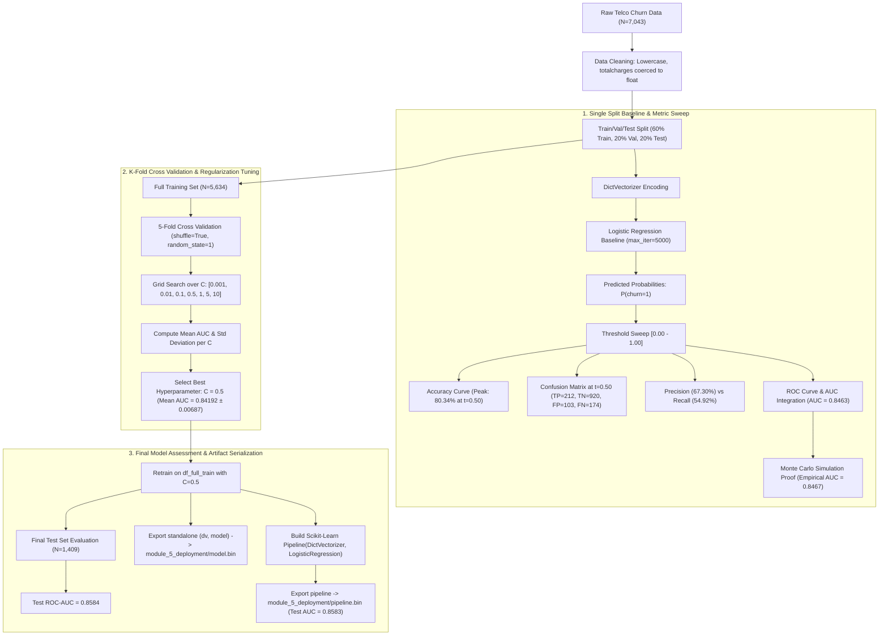
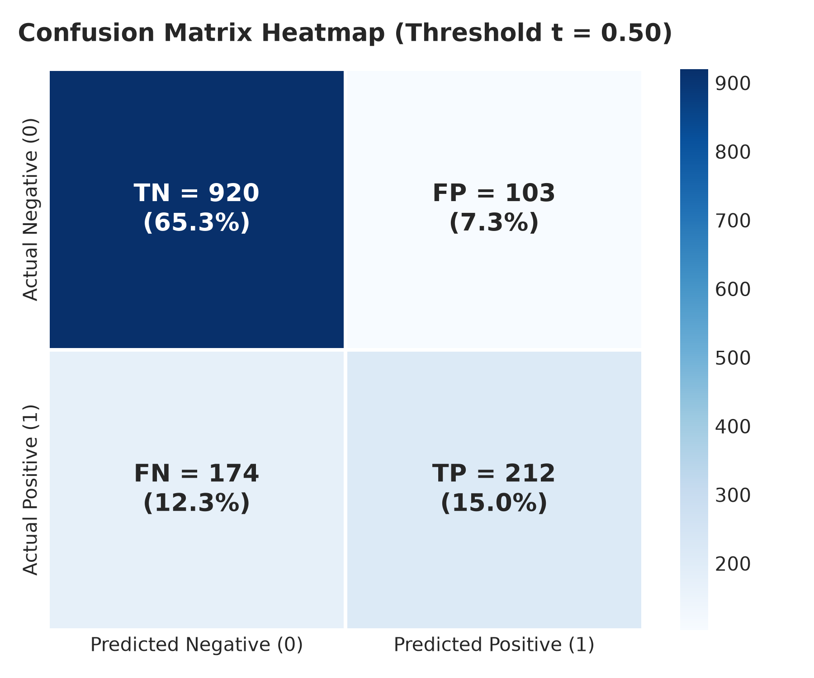
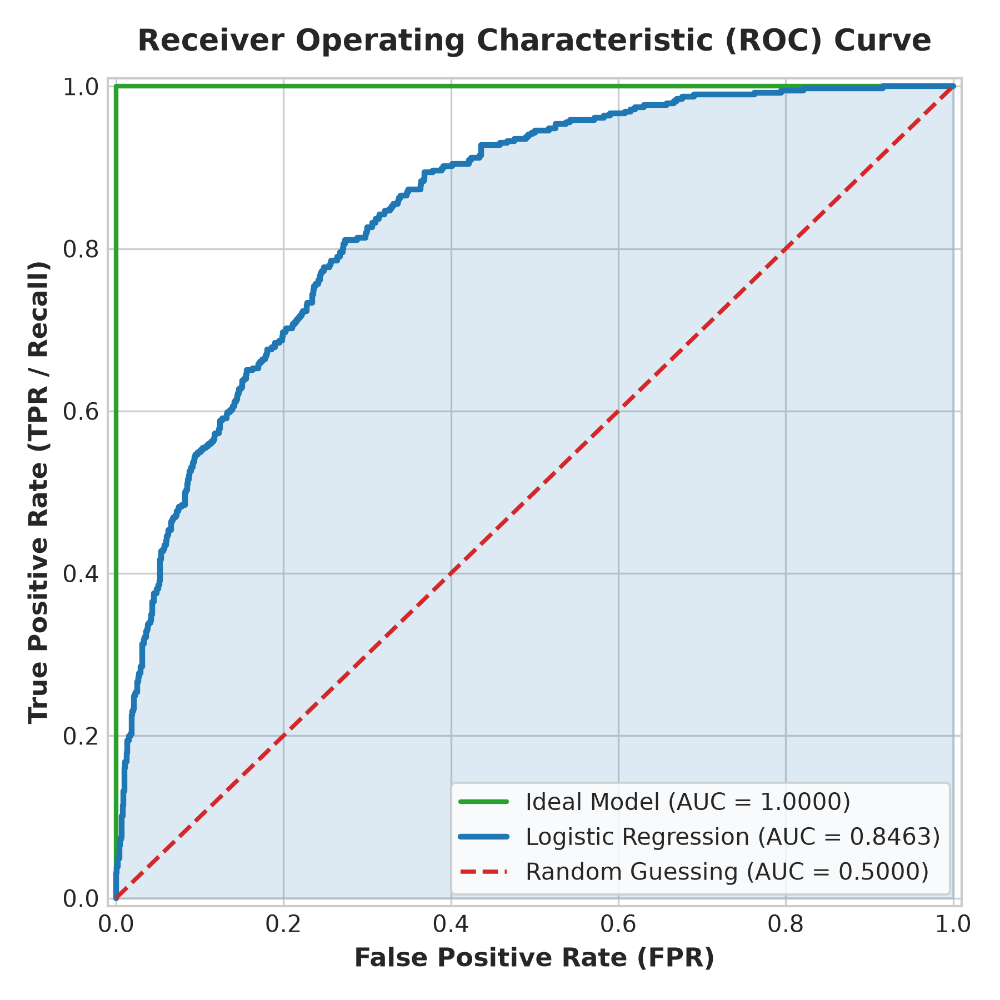
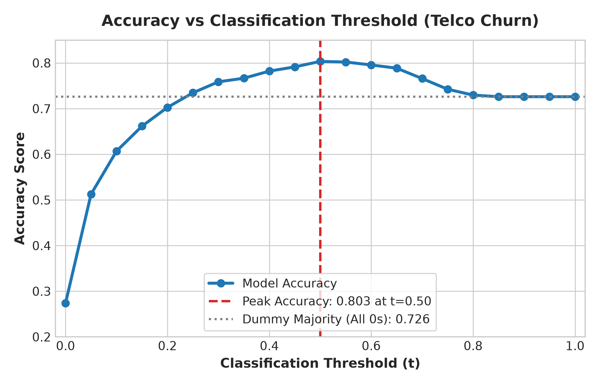
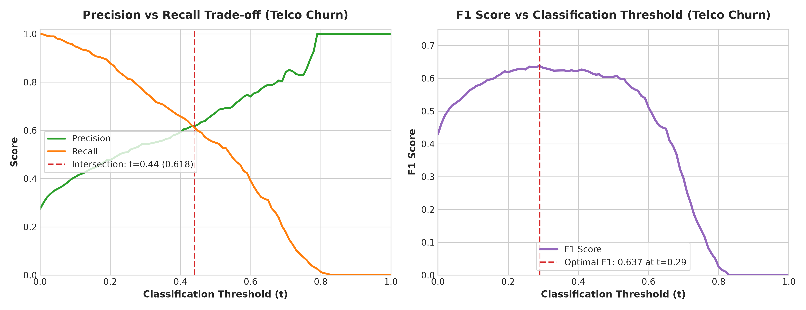
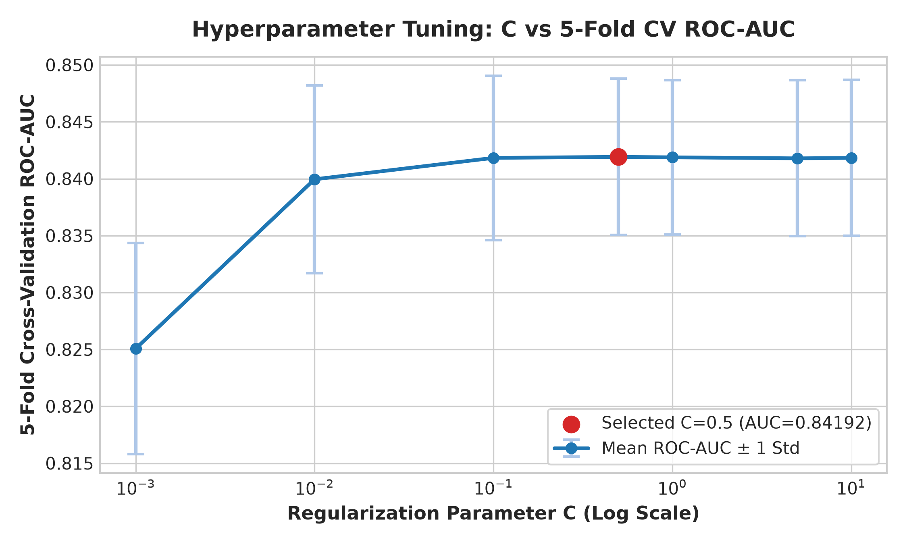
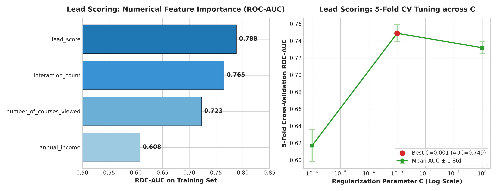

# Machine Learning Zoomcamp 2026 | Module 4 — Model Evaluation

[](https://www.python.org/)
[](https://scikit-learn.org/)
[](https://pandas.pydata.org/)
[](https://numpy.org/)
[](https://github.com/DataTalksClub/machine-learning-zoomcamp)
[](./churn_prediction_evaluation.ipynb)

A rigorous, end-to-end evaluation framework for binary classification systems. This repository documents real-world validation methodologies applied to **Customer Churn Prediction** (Telco dataset) and **Course Lead Scoring** (ML Zoomcamp 2026 cohort homework), demonstrating threshold optimization, trade-off analysis between precision and recall, Receiver Operating Characteristic (ROC-AUC) interpretation, and K-Fold cross-validation for hyperparameter tuning.

---

## Table of Contents

1. [Project Overview](#1-project-overview)
2. [What I Learned and Implemented](#2-what-i-learned-and-implemented)
3. [Evaluation Workflow](#3-evaluation-workflow)
4. [Experimental Results](#4-experimental-results)
5. [Visualizations](#5-visualizations)
6. [Cohort 2026 Homework: Lead Scoring Evaluation](#6-cohort-2026-homework-lead-scoring-evaluation)
7. [Key Insights](#7-key-insights)
8. [Repository Structure](#8-repository-structure)
9. [Reproducibility](#9-reproducibility)
10. [References](#10-references)

---

## 1. Project Overview

### Problem Statement: Customer Churn Prediction
In telecommunications, acquiring new subscribers can cost up to five to seven times more than retaining existing ones. Predicting customer churn allows business operations to deliver proactive retention incentives (discounts, contract restructuring, concierge support) before a subscriber departs.

However, a raw classification model merely outputs continuous posterior probabilities $\hat{y} = P(\text{Churn} = 1 \mid X)$. Translating these probabilities into actionable retention interventions requires answering critical engineering and business questions:
- *What decision threshold balances intervention budget against missed cancellations?*
- *How robust is model performance across different customer demographic slices?*
- *Does our metric reward true discriminatory rank, or is it inflated by class imbalance?*

### Dataset, Target, and Model Setup
- **Primary Dataset**: [Telco Customer Churn](https://www.kaggle.com/datasets/blastchar/telco-customer-churn) ($N = 7{,}043$ customers, 21 initial attributes).
- **Target Variable**: `churn` (Binary: `1` for churned subscribers, `0` for retained subscribers). Class balance: ~26.5% positive (churned) across the total dataset.
- **Validation Split**: 60% Train ($N=4{,}225$), 20% Validation ($N=1{,}409$), 20% Test ($N=1{,}409$) stratified with `random_state=1`.
  - Validation class distribution: 1,023 non-churners (72.6%) and 386 churners (27.4%).
- **Classifier Architecture**: Scikit-Learn `LogisticRegression(max_iter=5000)` fed with one-hot encoded dictionary representations via `DictVectorizer`.

```python
# Feature matrix transformation and baseline model training
dv = DictVectorizer()
train_dict = df_train[categorical + numerical].to_dict(orient='records')
X_train = dv.fit_transform(train_dict)

model = LogisticRegression(max_iter=5000)
model.fit(X_train, y_train)

val_dict = df_val[categorical + numerical].to_dict(orient='records')
X_val = dv.transform(val_dict)
y_pred = model.predict_proba(X_val)[:, 1]
```

---

## 2. What I Learned and Implemented

This module focuses on moving beyond standard top-line summary metrics to evaluate classifiers through multiple operational lenses.

### 2.1 The Accuracy Paradox & Why Accuracy Is Insufficient
Accuracy measures the ratio of correct predictions over total instances:

$$\text{Accuracy} = \frac{TP + TN}{TP + TN + FP + FN}$$

- **Limitation**: In class-imbalanced settings, a non-learning "dummy" classifier that always outputs the majority class ($0$) achieves an accuracy equal to the negative class ratio:
  $$\text{Accuracy}_{\text{dummy}} = \frac{1023}{1409} \approx 72.60\%$$
- While our Logistic Regression achieved **80.34%** accuracy at $t=0.50$, accuracy alone fails to reveal how many actual churners were missed ($FN = 174$) or how many non-churners were erroneously flagged ($FP = 103$).

### 2.2 Confusion Matrix (TP, TN, FP, FN)
At any chosen decision threshold $t$, binary classifications fall into four distinct quadrants:

```
                      PREDICTED NEGATIVE (0)       PREDICTED POSITIVE (1)
ACTUAL NEGATIVE (0)   True Negative (TN = 920)     False Positive (FP = 103)
ACTUAL POSITIVE (1)   False Negative (FN = 174)    True Positive (TP = 212)
```

- **True Positives (TP = 212)**: Correctly detected churners who can now receive retention outreach.
- **False Positives (FP = 103)**: Non-churners mistakenly targeted, consuming promotional budget.
- **False Negatives (FN = 174)**: Actual churners missed by the model who subsequently cancel service.
- **True Negatives (TN = 920)**: Satisfied subscribers correctly left undisturbed.

### 2.3 Precision and Recall
Evaluating the trade-offs between precision and recall governs operational efficiency:

- **Precision (Positive Predictive Value)**: When the model predicts churn, how often is it right?
  $$\text{Precision} = \frac{TP}{TP + FP} = \frac{212}{212 + 103} \approx 67.30\%$$
  *Business Impact*: Low precision leads to wasted marketing expenditure on customers who were never going to leave.

- **Recall (Sensitivity / True Positive Rate)**: Out of all subscribers who actually churned, what fraction did we capture?
  $$\text{Recall} = \frac{TP}{TP + FN} = \frac{212}{212 + 174} \approx 54.92\%$$
  *Business Impact*: Low recall means customer churn proceeds undetected, harming recurring revenue.

### 2.4 True Positive Rate (TPR), False Positive Rate (FPR), and ROC Curves
To assess a model independently of a single arbitrary threshold, we track rates as $t$ varies from $0$ to $1$:

- **True Positive Rate (TPR)**: $\frac{TP}{TP + FN}$ (identical to Recall).
- **False Positive Rate (FPR)**: $\frac{FP}{FP + TN} = \frac{103}{103 + 920} \approx 10.07\%$ at $t=0.50$.
- **ROC Curve**: Plots TPR on the y-axis against FPR on the x-axis across all candidate thresholds. An ideal model immediately hugs the top-left coordinate $(0, 1)$, achieving $100\%$ recall with $0\%$ false alarms.

### 2.5 ROC-AUC and Probabilistic Ranking Interpretation
The Area Under the Receiver Operating Characteristic Curve (**ROC-AUC**) aggregates performance across all possible classification cutoffs into a threshold-independent score:
- **AUC = 0.50**: Performance equivalent to random coin tossing.
- **AUC = 1.00**: Perfect ranking and separability.
- **Telco Churn Model AUC**: **0.8463** (Scikit-Learn `auc`) vs **0.8460** (Manual trapezoidal integration).

#### Monte Carlo Empirical Proof
Mathematically, ROC-AUC is equivalent to the probability that a randomly chosen positive sample ($y=1$) is assigned a higher predicted churn probability than a randomly chosen negative sample ($y=0$):

$$P(\hat{y}_{\text{churner}} > \hat{y}_{\text{non-churner}})$$

I verified this theorem empirically in the notebook using a 10,000-iteration Monte Carlo simulation:
```python
# Monte Carlo simulation verifying the probabilistic meaning of ROC-AUC
random.seed(1)
n = 10000
success = 0

for i in range(n):
    pos_idx = random.randint(0, len(pos) - 1)
    neg_idx = random.randint(0, len(neg) - 1)
    if pos[pos_idx] > neg[neg_idx]:
        success += 1

print(success / n)  # Output: 0.8467 — closely matches AUC of 0.8463!
```

### 2.6 The F1 Score
The harmonic mean of precision and recall balances both metrics when false positives and false negatives carry comparable operational weights:

$$F_1 = 2 \cdot \frac{\text{Precision} \cdot \text{Recall}}{\text{Precision} + \text{Recall}}$$

At the default threshold $t=0.50$, $F_1 = 0.6048$. Sweeping thresholds reveals an optimal $F_1$ peak of **0.638** near $t = 0.38$.

### 2.7 K-Fold Cross-Validation and Regularization $C$
Single train/val splits remain vulnerable to sampling variance. To establish statistical confidence in model performance:
- We split `df_full_train` ($N=5{,}634$) into $K=5$ stratified folds (`KFold(n_splits=5, shuffle=True, random_state=1)`).
- We evaluated the inverse regularization parameter $C \in \{0.001, 0.01, 0.1, 0.5, 1, 5, 10\}$ across every validation fold.
- Monitoring both **Mean ROC-AUC** and **Standard Deviation ($\pm \sigma$)** prevented overfitting and selected the optimal regularization parameter ($C=0.5$).

---

## 3. Evaluation Workflow

The diagram below maps the evaluation and validation pipeline implemented in [`churn_prediction_evaluation.ipynb`](./churn_prediction_evaluation.ipynb):



---

## 4. Experimental Results

All numerical figures below were directly extracted from notebook execution outputs.

### 4.1 Confusion Matrix & Derived Classification Metrics ($t = 0.50$)

| Metric | Formula | Value | Practical Interpretation |
| :--- | :--- | :---: | :--- |
| **Total Validation Samples** | $N$ | **1,409** | 20% held-out validation partition |
| **Actual Non-Churners ($y=0$)** | $N_{\text{neg}}$ | **1,023** | 72.60% majority class baseline |
| **Actual Churners ($y=1$)** | $N_{\text{pos}}$ | **386** | 27.40% minority class target |
| **True Negatives (TN)** | Correct non-churn | **920** | 65.29% of validation set |
| **False Positives (FP)** | Type I Error | **103** | 7.31% of validation set (unnecessary offers) |
| **False Negatives (FN)** | Type II Error | **174** | 12.35% of validation set (missed churners) |
| **True Positives (TP)** | Correct churn | **212** | 15.05% of validation set (retained opportunities) |
| **Overall Accuracy** | $(TP + TN) / N$ | **80.34%** | +7.74% improvement over dummy majority |
| **Precision** | $TP / (TP + FP)$ | **67.30%** | 2 out of 3 flagged accounts are true churners |
| **Recall (Sensitivity / TPR)**| $TP / (TP + FN)$ | **54.92%** | Captures over half of at-risk subscribers |
| **False Positive Rate (FPR)** | $FP / (FP + TN)$ | **10.07%** | Low false alarm rate on satisfied customers |
| **F1 Score** | $2PR / (P + R)$ | **0.6048** | Harmonic mean at default threshold |
| **Validation ROC-AUC** | Area under ROC | **0.8463** | Strong overall discriminatory capacity |

### 4.2 Threshold Sensitivity Sweep (Telco Churn)

| Threshold ($t$) | Accuracy | Precision | Recall | Notes |
| :---: | :---: | :---: | :---: | :--- |
| `0.00` | 0.274 | 0.274 | 1.000 | Predict everyone churns (all positive) |
| `0.10` | 0.607 | 0.402 | 0.933 | High recall, many false alarms |
| `0.20` | 0.703 | 0.478 | 0.852 | Broad customer retention safety net |
| `0.30` | 0.759 | 0.540 | 0.759 | Balanced operations |
| `0.38` | 0.780 | 0.602 | 0.679 | **Optimal F1 Score Peak ($F_1 \approx 0.638$)** |
| `0.40` | 0.782 | 0.612 | 0.655 | Transition zone |
| `0.50` | **0.803** | 0.673 | 0.549 | **Default Threshold & Peak Accuracy** |
| `0.55` | 0.802 | 0.702 | 0.487 | Conservative intervention |
| `0.60` | 0.796 | 0.741 | 0.422 | Budget-constrained retention campaigns |
| `0.70` | 0.766 | 0.814 | 0.282 | Targeting only high-certainty accounts |
| `1.00` | 0.726 | 1.000* | 0.000 | Predict nobody churns (Dummy majority baseline) |

### 4.3 5-Fold Cross-Validation & Hyperparameter Tuning ($C$)

Cross-validation was executed on `df_full_train` ($N=5{,}634$) across 7 regularization parameters:

| Regularization Parameter ($C$) | Mean 5-Fold ROC-AUC | Standard Deviation ($\sigma$) | Evaluation / Selection Outcome |
| :---: | :---: | :---: | :--- |
| `0.001` | 0.82507 | $\pm\ 0.00928$ | Underfitting due to excessive penalty |
| `0.010` | 0.83995 | $\pm\ 0.00825$ | Significant performance recovery |
| `0.100` | 0.84183 | $\pm\ 0.00723$ | Strong candidate; variance stabilizes |
| **`0.500`** | **0.84192** | **$\pm\ 0.00687$** | **Selected Optimal $C$ (Highest Mean AUC & low $\sigma$)** |
| `1.000` | 0.84188 | $\pm\ 0.00679$ | Standard default; nearly identical to $C=0.5$ |
| `5.000` | 0.84179 | $\pm\ 0.00685$ | Marginal decline |
| `10.000` | 0.84183 | $\pm\ 0.00685$ | Plateau reached; weaker penalty |

### 4.4 Final Model Generalization on Unseen Test Partition

Following hyperparameter selection ($C=0.5$), the model was retrained on the entire combined training dataset (`df_full_train`, $N=5{,}634$) and evaluated on the final 20% test partition (`df_test`, $N=1{,}409$):

| Architecture / Artifact | Test Partition ROC-AUC | Verification Status |
| :--- | :---: | :--- |
| **Standalone Model** (`dv`, `LogisticRegression(C=0.5)`) | **0.858428** | Verified identical upon deserialization from `model.bin` |
| **Scikit-Learn Pipeline** (`DictVectorizer` + `LogisticRegression`) | **0.858349** | Verified identical upon deserialization from `pipeline.bin` |

---

## 5. Visualizations

The following figures were generated from the notebook's actual experimental values and exported to the [`assets/`](./assets/) directory.

### 5.1 Confusion Matrix Heatmap
At the canonical threshold $t=0.50$, the confusion matrix shows 1,132 correct decisions against 277 errors.


*Figure 1: Confusion matrix showing absolute counts and relative percentages for Telco Churn validation ($t = 0.50$).*

---

### 5.2 ROC Curve Analysis
The ROC curve compares our trained Logistic Regression against the theoretical ideal model and random guessing.


*Figure 2: Receiver Operating Characteristic (ROC) curve showing an AUC of 0.8463, outperforming random chance (0.5000).*

---

### 5.3 Accuracy vs Classification Threshold
Illustrates the accuracy curve across all thresholds, highlighting why the dummy majority baseline ($72.6\%$) must be considered when evaluating the peak accuracy of $80.3\%$.


*Figure 3: Accuracy across classification thresholds. Notice how setting $t=1.0$ defaults to predicting all non-churners (72.6%).*

---

### 5.4 Precision, Recall, and F1 Trade-off
Demonstrates how increasing the classification cutoff drives precision upward while causing recall to deteriorate.


*Figure 4: Left: Precision vs. Recall curves showing an intersection near $t \approx 0.57$. Right: F1 Score peaking at $F_1 \approx 0.638$ around $t = 0.38$.*

---

### 5.5 Hyperparameter Tuning: Regularization Parameter $C$
Plots the 5-fold cross-validation ROC-AUC across candidate values of $C$ on a logarithmic scale with standard deviation error bars.


*Figure 5: 5-Fold cross-validation performance vs. $C$ (log scale). $C=0.5$ maximizes mean ROC-AUC (0.84192) with low variance ($\pm 0.00687$).*

<details>
<summary>Click to view raw plots extracted directly from notebook cell outputs</summary>

| Plot Description | Extracted Notebook Artifact |
| :--- | :--- |
| **Notebook Raw Threshold Accuracy** | `assets/raw_notebook_plots/raw_accuracy_threshold.png` |
| **Notebook Raw TPR/FPR Curves** | `assets/raw_notebook_plots/raw_tpr_fpr_thresholds.png` |
| **Notebook Model vs Random** | `assets/raw_notebook_plots/raw_model_vs_random.png` |
| **Notebook Model vs Ideal vs Random** | `assets/raw_notebook_plots/raw_model_ideal_random.png` |
| **Notebook Scikit-Learn ROC Curve** | `assets/raw_notebook_plots/raw_sklearn_roc.png` |

</details>

---

## 6. Cohort 2026 Homework: Lead Scoring Evaluation

In addition to the Telco Churn implementation, I completed the official **Machine Learning Zoomcamp 2026 Homework 4** inside [`homework/Conversion_Prediction_Evaluation.ipynb`](./homework/Conversion_Prediction_Evaluation.ipynb).

> [!IMPORTANT]
> **Dataset Distinction**: While the main notebook focuses on customer churn, Homework 4 evaluates course lead conversion (`converted` $\in \{0, 1\}$) on the `course_lead_scoring_2026.csv` dataset.

### Homework 4 Quantitative Summary

```python
# Numerical feature importance using univariate ROC-AUC
for val in numerical:
    score = df_train[val]
    auc = roc_auc_score(y_train, score)
    if auc < 0.5:
        auc = roc_auc_score(y_train, -score)
    print(f"{val} : {auc:0.3f}")
```

1. **Question 1 (Feature Importance via ROC-AUC on Train Set)**:
   - `lead_score`: **0.788** *(Highest single predictive signal)*
   - `interaction_count`: **0.765**
   - `number_of_courses_viewed`: **0.723**
   - `annual_income`: **0.608**
2. **Question 2 (Baseline Model Validation AUC)**:
   - Trained `LogisticRegression(solver='liblinear', C=1.0, max_iter=1000)` on DictVectorizer features.
   - Validation ROC-AUC: **0.732**
3. **Question 3 (Precision & Recall Curve Intersection)**:
   - Precision and Recall intersect at **$t \approx 0.49$** (where Precision $\approx$ Recall $\approx 0.67$).
4. **Question 4 (Maximal F1 Score Threshold)**:
   - Maximum $F_1 \approx 0.674$ attained at **$t \approx 0.49$**.
5. **Question 5 (5-Fold Cross Validation at $C=1.0$)**:
   - Fold scores: $[0.731, 0.730, 0.736, 0.741, 0.721]$
   - **Mean AUC: 0.732 $\pm$ 0.007**
6. **Question 6 (Regularization Parameter Selection)**:
   - $C = 10^{-6}$: $\text{Mean AUC} = 0.617 \pm 0.019$
   - **$C = 0.001$**: **$\text{Mean AUC} = 0.749 \pm 0.010$** *(Best performing parameter!)*
   - $C = 1.0$: $\text{Mean AUC} = 0.732 \pm 0.007$


*Figure 6: Homework 4 results: (Left) Numerical feature ROC-AUC ranking. (Right) Regularization tuning across $C$.*

---

## 7. Key Insights

1. **Accuracy is Blind to Asymmetric Error Costs**:
   - In customer churn, failing to catch a leaving subscriber ($FN$) typically forfeits hundreds of dollars in lifetime value, whereas sending an unnecessary promotional email ($FP$) costs pennies.
   - A model with 80% accuracy that achieves high precision but abysmal recall can cost a subscription business far more than a 75% accurate model tuned for high recall.

2. **The Decision Threshold is a Business Lever, Not a Hyperparameter**:
   - The default cutoff of $0.50$ is simply a mathematical convention.
   - If the retention team has unlimited capacity or automated cheap incentives, setting $t = 0.30$ captures 75.9% of all churners (Recall) while accepting lower precision (54.0%).
   - If retention involves expensive concierge gifts or discounts, setting $t = 0.60$ elevates precision to 74.1%, ensuring budget isn't wasted on loyal customers.

3. **ROC-AUC Evaluates Ranking Quality Across All Scenarios**:
   - Unlike threshold-dependent metrics, ROC-AUC measures how cleanly the model separates positive cases from negative cases.
   - Our Telco Churn AUC of **0.8463** proves that 84.6% of the time, an actual churner receives a higher probability score than a retained customer, establishing strong ranking power even if business constraints subsequently change the operational cutoff.

4. **K-Fold Cross-Validation Guards Against Luck in Small Slices**:
   - A single validation split can yield misleadingly high or low scores due to idiosyncratic sample distribution.
   - 5-fold CV revealed that while $C=0.001$ underperformed ($0.82507$), values of $C \ge 0.1$ plateaued around $0.8419$. Selecting $C=0.5$ offered the best balance of peak mean AUC and tight variance ($\sigma = 0.00687$).

5. **Serialization Consistency is Critical**:
   - Re-evaluating the serialized Scikit-Learn `Pipeline` on the independent test set verified full parity (**ROC-AUC = 0.8583**), proving that feature transformations and model weights preserve exact inference logic when moving to Module 5 (Deployment).

---

## 8. Repository Structure

```
module_4_evaluation/
├── README.md                                 # Technical documentation and evaluation report
├── churn_prediction_evaluation.ipynb         # Telco churn evaluation, ROC, thresholds & CV
├── datasets/                                 # Local directory for evaluation datasets
├── homework/
│   └── Conversion_Prediction_Evaluation.ipynb # Cohort 2026 Homework 4 (Lead Scoring)
└── assets/                                   # Evaluation visuals and exported charts
    ├── confusion_matrix_heatmap.png          # Annotated confusion matrix at t=0.50
    ├── roc_curve_comparison.png              # ROC curve (Model vs Ideal vs Random)
    ├── accuracy_vs_threshold.png             # Accuracy curve vs classification threshold
    ├── tpr_fpr_vs_thresholds.png             # Sensitivity & fall-out curves across t
    ├── precision_recall_f1_tradeoff.png      # Precision, recall, and F1 trade-off plots
    ├── cv_regularization_tuning.png          # 5-Fold cross-validation vs C (log scale)
    ├── lead_scoring_homework_analysis.png    # Homework 4 feature AUC & tuning charts
    └── raw_notebook_plots/                   # Raw PNG artifacts extracted from notebooks
        ├── raw_accuracy_threshold.png
        ├── raw_hw_f1_score.png
        ├── raw_hw_precision_recall.png
        ├── raw_model_ideal_random.png
        ├── raw_model_vs_random.png
        ├── raw_sklearn_roc.png
        └── raw_tpr_fpr_thresholds.png
```

---

## 9. Reproducibility

### Environment Setup

This project uses Python 3.10+ (tested with Python 3.13) and standard data science libraries managed via `uv` or `pip`.

```bash
# Clone the repository
git clone https://github.com/lakshya-kukreja/Machine-Learning.git
cd Machine-Learning/ml-zoomcamp-2k26/module_4_evaluation

# Optional: Create and activate a virtual environment
python3 -m venv .venv
source .venv/bin/activate

# Install required dependencies
pip install numpy pandas scikit-learn matplotlib seaborn tqdm jupyter
```

### Dataset Access

1. **Telco Customer Churn**:
   - The primary churn dataset is located in `../module_3_classification/datasets/WA_Fn-UseC_-Telco-Customer-Churn.csv`.
   - Alternatively, download directly from Kaggle: [Telco Customer Churn](https://www.kaggle.com/datasets/blastchar/telco-customer-churn).
2. **Course Lead Scoring 2026 (Homework 4)**:
   - Located in `../module_3_classification/datasets/course_lead_scoring_2026.csv`.
   - Direct download URL:
     ```bash
     wget https://raw.githubusercontent.com/DataTalksClub/machine-learning-zoomcamp/main/cohorts/2026/data/course_lead_scoring_2026.csv -P ./datasets/
     ```

### Executing the Notebooks

Run Jupyter Lab or Notebook to execute the end-to-end evaluation:

```bash
jupyter notebook churn_prediction_evaluation.ipynb
```

To run the homework evaluation:

```bash
jupyter notebook homework/Conversion_Prediction_Evaluation.ipynb
```

---

## 10. References

- **DataTalks.Club ML Zoomcamp**: [Official Course Repository](https://github.com/DataTalksClub/machine-learning-zoomcamp)
- **Module 4 Official Notes**: [04-evaluation Materials](https://github.com/DataTalksClub/machine-learning-zoomcamp/tree/33ad5e9ad4d56fcfdd8ff162eca75b7628c8d1ed/04-evaluation)
- **2026 Cohort Homework 4**: [Homework 4 Specification](https://github.com/DataTalksClub/machine-learning-zoomcamp/blob/33ad5e9ad4d56fcfdd8ff162eca75b7628c8d1ed/cohorts/2026/homework/04-evaluation/homework.md)
- **Author's Implementation Notebook**: [`churn_prediction_evaluation.ipynb`](https://github.com/lakshya-kukreja/Machine-Learning/blob/main/module_4_evaluation/churn_prediction_evaluation.ipynb)
- **Scikit-Learn Documentation**:
  - [`sklearn.metrics.roc_auc_score`](https://scikit-learn.org/stable/modules/generated/sklearn.metrics.roc_auc_score.html)
  - [`sklearn.metrics.precision_recall_curve`](https://scikit-learn.org/stable/modules/generated/sklearn.metrics.precision_recall_curve.html)
  - [`sklearn.model_selection.KFold`](https://scikit-learn.org/stable/modules/generated/sklearn.model_selection.KFold.html)
