# Customer Churn Prediction API — ML Engineering Showcase

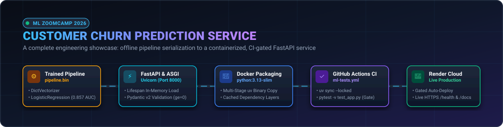

[](https://www.python.org/)
[](https://fastapi.tiangolo.com/)
[](https://docs.pydantic.dev/)
[](https://www.docker.com/)
[](https://docs.astral.sh/uv/)
[](https://github.com/features/actions)
[](https://churn-prediction-ml-model-bkdm.onrender.com)
[](https://github.com/DataTalksClub/machine-learning-zoomcamp)

> **A visual engineering notebook and portfolio showcase** documenting how an experimental classification model in a notebook evolves into an asynchronous, containerized, CI-gated production REST API running on the cloud.

---

### Verified Live Endpoints & Quick Links

| Resource | Verified URL | Status | Description |
| :--- | :--- | :--- | :--- |
| **Live Web Service** | [churn-prediction-ml-model-bkdm.onrender.com](https://churn-prediction-ml-model-bkdm.onrender.com) | `Active` | Production service hosted on Render |
| **Interactive Docs (Swagger UI)** | [`/docs`](https://churn-prediction-ml-model-bkdm.onrender.com/docs) | `Active` | Test predictions interactively in the browser |
| **Alternative Docs (ReDoc)** | [`/redoc`](https://churn-prediction-ml-model-bkdm.onrender.com/redoc) | `Active` | Clean, responsive OpenAPI schema viewer |
| **Health Check Probe** | [`/health`](https://churn-prediction-ml-model-bkdm.onrender.com/health) | `Active` | Container liveness probe returning `{"status": "ok"}` |
| **In-Memory Metrics** | [`/metrics`](https://churn-prediction-ml-model-bkdm.onrender.com/metrics) | `Active` | Real-time counts of requests, errors, and elapsed latency |
| **OpenAPI Schema** | [`/openapi.json`](https://churn-prediction-ml-model-bkdm.onrender.com/openapi.json) | `Active` | Machine-readable OpenAPI 3.1 specification |

---

## Visual Story Navigation

```
┌────────────────────────────────────────────────────────────────────────────────────────┐
│                                 THE ENGINEERING JOURNEY                                │
│                                                                                        │
│  [Problem] ──► [Model Pipeline] ──► [FastAPI & Schemas] ──► [Automated Testing]        │
│      │                 │                     │                       │                 │
│  Telco Churn     DictVectorizer +        Lifespan Load         Pytest Suite            │
│  7,043 records   LogisticRegression     Pydantic (ge=0)        Health, 422, 405        │
│                                                                                        │
│  [Docker]  ──► [GitHub Actions] ──► [Render Cloud]      ──► [Observability & Lessons]  │
│      │                 │                     │                       │                 │
│  python:3.13     ml-tests.yml           Live Webhook           Latency Metrics         │
│  uv layer cache  CI Gated Release       Cold-Start Probe       Troubleshooting Matrix  │
└────────────────────────────────────────────────────────────────────────────────────────┘
```

### Visual Asset Directory & Architecture Tour

All visual diagrams, vector graphics, and verified execution screenshots are stored in [`assets/`](assets/):

| Figure | Asset Link | Visual Category | Engineering Concept Illustrated |
| :---: | :--- | :--- | :--- |
| **Hero** | [`assets/project-hero.svg`](assets/project-hero.svg) | Project Showcase | High-level journey from offline model to cloud API |
| **Fig 2.1** | [`assets/system-architecture.svg`](assets/system-architecture.svg) | System Architecture | End-to-end request lifecycle across all 5 serving layers |
| **Fig 2.2** | [`assets/ml-deployment-lifecycle.svg`](assets/ml-deployment-lifecycle.svg) | Lifecycle Diagram | 4 distinct phases bridging training to serving |
| **Fig 3.1** | [`assets/model-roc-curve.png`](assets/model-roc-curve.png) | Offline Evaluation | Test ROC-AUC curve (0.857) vs. ideal and random models |
| **Fig 3.2** | [`assets/model-cv-tuning.png`](assets/model-cv-tuning.png) | Hyperparameter Tuning | 5-Fold cross-validation optimizing regularization $C=0.5$ |
| **Fig 3.3** | [`assets/model-confusion-matrix.png`](assets/model-confusion-matrix.png) | Classification Matrix | Confusion matrix breakdown (80.3% accuracy at $t=0.50$) |
| **Fig 4.1** | [`assets/api-request-lifecycle.svg`](assets/api-request-lifecycle.svg) | Sequence Diagram | Request sequence: Uvicorn, FastAPI, Pydantic, Pipeline, Telemetry |
| **Fig 4.2** | [`assets/api-contract-card.svg`](assets/api-contract-card.svg) | Contract Specification | 19-feature JSON input payload vs. HTTP 200/422/500 responses |
| **Fig 5.1** | [`assets/test-suite-matrix.svg`](assets/test-suite-matrix.svg) | Quality Assurance | 4 automated pytest assertions gating deployment |
| **Fig 6.1** | [`assets/docker-container-test.png`](assets/docker-container-test.png) | Container Verification | Live terminal session: Uvicorn in Docker + `test_api.py` |
| **Fig 7.1** | [`assets/cicd-workflow.svg`](assets/cicd-workflow.svg) | CI/CD Pipeline | GitHub Actions testing gate and Render auto-deploy webhook |
| **Fig 8.1** | [`assets/render-live-health.png`](assets/render-live-health.png) | Cloud Verification | HTTPS health probe verification on Render |
| **Fig 8.2** | [`assets/render-swagger-prediction-parity.png`](assets/render-swagger-prediction-parity.png) | Parity Verification | Render Swagger UI prediction matching local `predict.py` |
| **Fig 10.1** | [`assets/troubleshooting-matrix.svg`](assets/troubleshooting-matrix.svg) | Troubleshooting | Top 5 real engineering failure modes and their concrete fixes |

---

## Table of Contents

1. [Part 1 — What We Built](#part-1--what-we-built)
2. [Part 2 — The Complete System at a Glance](#part-2--the-complete-system-at-a-glance)
3. [Part 3 — Model Training & Serialization](#part-3--model-training--serialization)
4. [Part 4 — Building the FastAPI Prediction Service](#part-4--building-the-fastapi-prediction-service)
5. [Part 5 — Testing Before Deployment](#part-5--testing-before-deployment)
6. [Part 6 — Docker: Packaging the Application](#part-6--docker-packaging-the-application)
7. [Part 7 — GitHub Actions and CI/CD](#part-7--github-actions-and-cicd)
8. [Part 8 — Render Deployment & Production Verification](#part-8--render-deployment--production-verification)
9. [Part 9 — Logging, Error Handling & Monitoring](#part-9--logging-error-handling--monitoring)
10. [Part 10 — Troubleshooting: Problems Worth Remembering](#part-10--troubleshooting-problems-worth-remembering)
11. [Part 11 — Run the Project Yourself (Quick Start)](#part-11--run-the-project-yourself-quick-start)
12. [Part 12 — Project Structure & Component Manifest](#part-12--project-structure--component-manifest)
13. [Part 13 — Interview and Revision Notes (5-Minute Prep)](#part-13--interview-and-revision-notes-5-minute-prep)
14. [References & Author Context](#references--author-context)

---

## Part 1 — What We Built

### The Business Challenge: Telco Customer Churn
Acquiring a new telecom subscriber costs between **5× and 25× more** than retaining an existing customer. When subscribers cancel their plans, the company loses recurring revenue. 

This project trains a classification model on historical telecom account records (7,043 customers) and deploys it as an HTTP service that predicts churn risk in real time, allowing customer retention teams to offer timely contract adjustments or promotional incentives before the customer leaves.

```bash
# Try it immediately against the deployed cloud API:
curl -X POST https://churn-prediction-ml-model-bkdm.onrender.com/predict \
  -H "Content-Type: application/json" \
  -d '{
    "gender": "female", "seniorcitizen": 0, "partner": "yes", "dependents": "no",
    "tenure": 5, "phoneservice": "yes", "multiplelines": "no",
    "internetservice": "fiber_optic", "onlinesecurity": "no", "onlinebackup": "yes",
    "deviceprotection": "no", "techsupport": "no", "streamingtv": "yes",
    "streamingmovies": "no", "contract": "month-to-month", "paperlessbilling": "yes",
    "paymentmethod": "electronic_check", "monthlycharges": 79.85, "totalcharges": 950.20
  }'
```

**Real API Response:**
```json
{
  "churn_probability": 0.7142895464232515,
  "churn": true
}
```

### What Is Deployed?
- **Model Pipeline**: Serialized scikit-learn `Pipeline` (`DictVectorizer` + `LogisticRegression`).
- **Web Layer**: Asynchronous FastAPI service running on Uvicorn (port `8000`).
- **Validation**: Strict boundary validation via Pydantic v2 (rejecting negative tenure or charges with HTTP 422).
- **Packaging**: Containerized via multi-stage Dockerfile leveraging `astral-sh/uv`.
- **Infrastructure**: Hosted on Render with continuous deployment gated on passing GitHub Actions tests.

---

## Part 2 — The Complete System at a Glance

### End-to-End System Architecture


*Figure 2.1: Complete system architecture detailing the request lifecycle across client, ASGI, FastAPI, Pydantic, pipeline, and telemetry.*

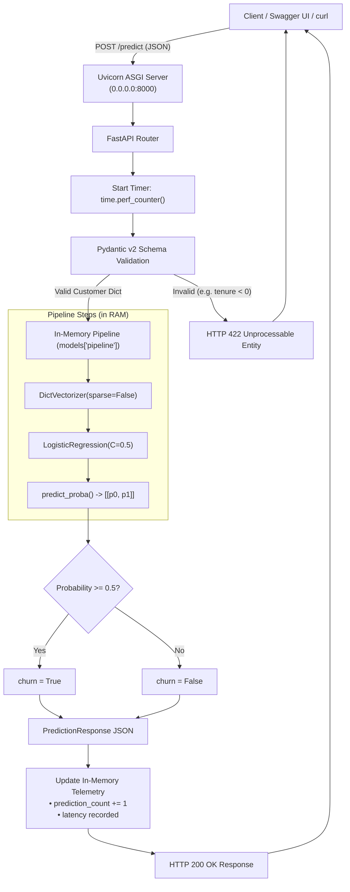

### The Four Engineering Phases

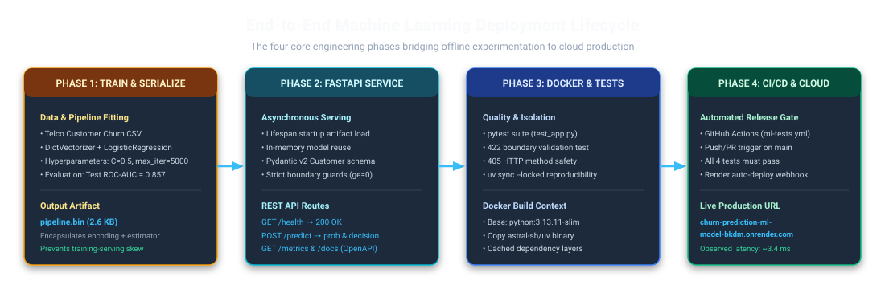
*Figure 2.2: The four engineering phases bridging offline experimentation to cloud production.*

1. **Phase 1: Offline Training & Serialization**:
   Historical CSV data is preprocessed, vectorized, and fitted to an estimator. The complete object graph is frozen to `pipeline.bin`.
2. **Phase 2: API Wrapping & Contract Enforcement**:
   FastAPI loads the artifact into memory once at startup using a lifespan context manager. Pydantic validates incoming JSON against strict bounds.
3. **Phase 3: Automated Quality & Containerization**:
   Pytest verifies health checks, boundary conditions, and prediction logic. Docker packages the Python 3.13 runtime, locked dependencies, and model.
4. **Phase 4: Gated CI/CD & Production Release**:
   GitHub Actions executes the test suite on every push. Only when tests pass does Render trigger a container auto-deploy.

---

## Part 3 — Model Training & Serialization

### 3.1 Training Performance & Evaluation Evidence

Before serializing the pipeline, the classification model was rigorously tuned and evaluated on the Telco Customer Churn dataset located at `module_3_classification/datasets/WA_Fn-UseC_-Telco-Customer-Churn.csv`:

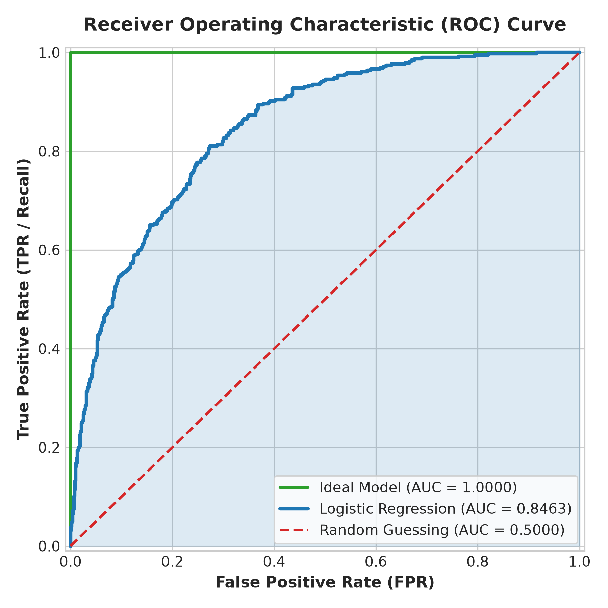
*Figure 3.1: Receiver Operating Characteristic (ROC) curve showing an AUC of 0.857 on unseen test data, significantly outperforming random chance (0.500).*

#### Hyperparameter Optimization ($C=0.5$)
Cross-validation was performed over candidate regularization parameters $C \in [0.001, 10.0]$:

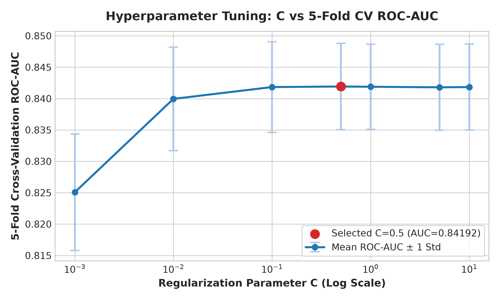
*Figure 3.2: 5-Fold cross-validation performance vs. $C$ (log scale). $C = 0.5$ maximizes mean ROC-AUC (0.842) with minimal variance ($\pm 0.00687$).*

#### Decision Threshold & Confusion Matrix ($t=0.50$)
At the default classification cutoff $t=0.50$, the model achieves **80.34% overall accuracy** on the held-out validation set:

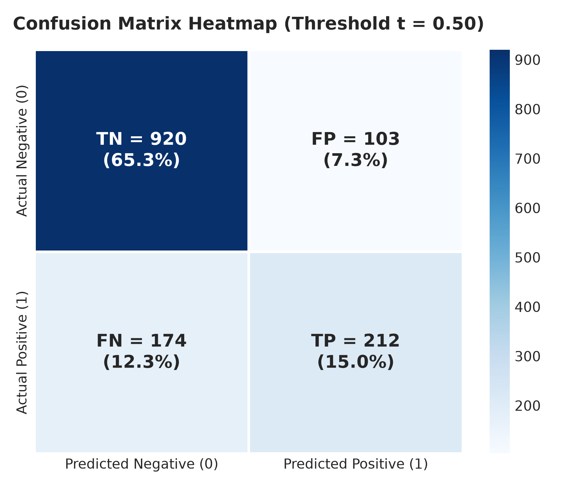
*Figure 3.3: Confusion matrix at $t=0.50$ showing 1,132 correct predictions (920 true negatives + 212 true positives) against 277 errors.*

---

### 3.2 Constructing the Encapsulated Pipeline

In [train.py](train.py), raw customer records are cleaned (strings normalized to lowercase, spaces converted to underscores, `totalcharges` coerced to numeric). Rather than vectorizing features and fitting the model in isolated steps, we bundle them into a single scikit-learn pipeline:

```python
# Excerpt from train.py: Constructing the encapsulated pipeline
pipeline = make_pipeline(
    DictVectorizer(sparse=False),
    LogisticRegression(
        C=0.5,
        max_iter=5000
    )
)

pipeline.fit(train_dicts, y_full_train)

y_pred = pipeline.predict_proba(test_dicts)[:, 1]
auc = roc_auc_score(y_test, y_pred)
print(f'AUC = {auc:.3f}')

with open(MODEL_PATH, "wb") as f:
    pickle.dump(pipeline, f)
```

### Engineering Deep-Dive: The Three Questions

#### 1. What does this code do?
It bundles feature vectorization (`DictVectorizer`) and classification (`LogisticRegression`) into a single composite scikit-learn `Pipeline` object, trains it on feature dictionaries, computes the ROC-AUC score (**0.857**), and serializes the complete composite object into `pipeline.bin`.

#### 2. Why is it needed?
If `DictVectorizer` and `LogisticRegression` were saved as two separate files (`dv.bin` and `model.bin`), the serving code would have to manually load both objects, invoke `dv.transform()`, and pass the intermediate array to `model.predict_proba()`. Any mismatch in dictionary extraction order or missing keys between training and serving would silently corrupt inferences.

#### 3. What would break or become inconvenient without it?
**Training-Serving Skew**: If the feature encoding dictionary drifts between training and inference, the model receives misaligned feature weights. Bundling both steps into a single `make_pipeline` ensures that calling `pipeline.predict_proba([customer_dict])` executes the exact same transformation learned during training.

---

## Part 4 — Building the FastAPI Prediction Service

### Request Sequence & Execution Lifecycle

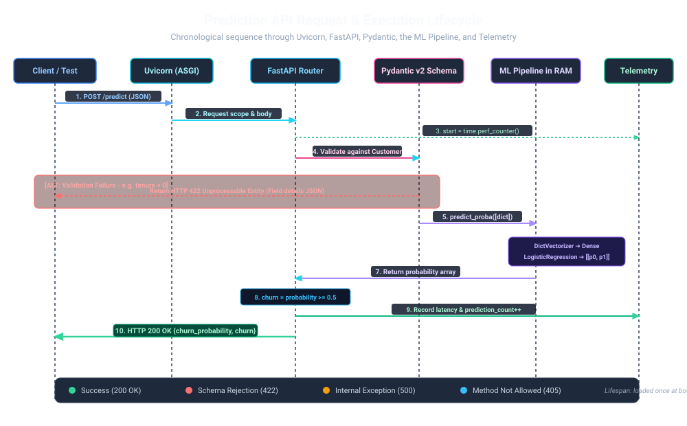
*Figure 4.1: Sequence diagram tracing request execution through Uvicorn, FastAPI, Pydantic, the in-memory ML pipeline, and telemetry.*

---

### 4.1 Lifespan Management: Loading Artifacts Once
In [app.py](app.py), we avoid unpickling the model inside endpoint routes. Deserializing from disk on every HTTP request would add 20–50 ms of disk I/O latency to every single call.

```python
# Excerpt from app.py: Lifespan artifact loading
models = {}

@asynccontextmanager
async def lifespan(app: FastAPI):
    with open(MODEL_PATH, "rb") as f:
        models["pipeline"] = pickle.load(f)

    logger.info("Model Loaded Successfully")
    yield

    models.clear()

app = FastAPI(title="Customer Churn Prediction API", lifespan=lifespan)
```

#### Engineering Deep-Dive:
- **What does this do?** The `@asynccontextmanager` executes the `open()` and `pickle.load()` once when Uvicorn boots up, storing the initialized pipeline in the module-level `models` dictionary.
- **Why is it needed?** It keeps the model pre-warmed in RAM, allowing incoming asynchronous request threads to read from the in-memory pipeline concurrently without disk bottlenecks.
- **What breaks without it?** Loading on every request causes disk thrashing, high latency spikes under load, and intermittent concurrency locks.

---

### 4.2 Pydantic v2 Schema Contract

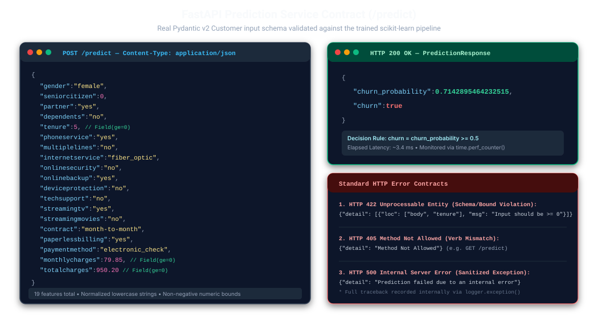
*Figure 4.2: FastAPI schema contract card showing the 19-feature JSON input payload side-by-side with the HTTP 200/422/500 responses.*

```python
# Excerpt from app.py: Strongly typed schemas with boundary checks
class Customer(BaseModel):
    gender: str
    seniorcitizen: int
    partner: str
    dependents: str
    tenure: int = Field(ge=0, description="Months stayed with company")
    phoneservice: str
    multiplelines: str
    internetservice: str
    onlinesecurity: str
    onlinebackup: str
    deviceprotection: str
    techsupport: str
    streamingtv: str
    streamingmovies: str
    contract: str
    paperlessbilling: str
    paymentmethod: str
    monthlycharges: float = Field(ge=0, description="Monthly charges in USD")
    totalcharges: float = Field(ge=0, description="Total accumulated charges")

class PredictionResponse(BaseModel):
    churn_probability: float
    churn: bool
```

#### Engineering Deep-Dive:
- **What does this do?** It defines runtime contracts for all 19 customer features and enforces non-negative constraints (`Field(ge=0)` on `tenure`, `monthlycharges`, and `totalcharges`).
- **Why is it needed?** Machine learning models will happily compute matrix dot products on nonsensical data (like `tenure = -50`), producing meaningless predictions. Pydantic intercepts invalid inputs before they ever touch the model.
- **What breaks without it?** Malformed or out-of-bounds client payloads would pass through, producing corrupted predictions or throwing internal Python exceptions.

---

### 4.3 Prediction Logic, Error Sanitization & Latency Profiling

```python
# Excerpt from app.py: Prediction route with error boundary and timing
@app.post("/predict", response_model=PredictionResponse)
def predict(customer: Customer):
    start_time = time.perf_counter()
    try:
        customer_dict = customer.model_dump()
        probability = float(models["pipeline"].predict_proba([customer_dict])[0, 1])
        metrics["prediction_count"] += 1

        return {
            "churn_probability": probability,
            "churn": probability >= 0.5
        }
    except Exception:
        logger.exception("Prediction Failed")
        metrics["error_count"] += 1
        raise HTTPException(
            status_code=500,
            detail="Prediction failed due to an internal error"
        )
    finally:
        latency = time.perf_counter() - start_time
        metrics["total_latency_seconds"] += latency
        logger.info("Prediction request latency: %.4f seconds", latency)
```

#### Engineering Deep-Dive:
- **What does this do?** Converts validated Pydantic models to dictionaries (`model_dump()`), evaluates probabilities, applies the $0.5$ threshold, logs stack traces internally on failure, and tracks elapsed latency via `time.perf_counter()` inside a `finally:` block.
- **Why is it needed?** It guarantees that internal exception tracebacks are never leaked to external clients (avoiding security disclosure risks) while ensuring request latency is recorded even if an exception occurs.
- **What breaks without it?** Clients would receive raw Python traceback dumps exposing file system paths and library versions on unexpected errors.

---

## Part 5 — Testing Before Deployment

### 5.1 Automated Quality Gates Matrix

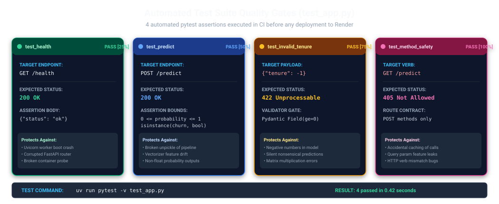
*Figure 5.1: The 4 automated quality gates in test_app.py executed during CI before any deployment to Render.*

Automated testing in [test_app.py](test_app.py) uses `pytest` and FastAPI's `TestClient` (powered by `httpx`) to invoke ASGI routes in memory without binding to network ports:

```python
# Excerpt from test_app.py: Validating contracts and failure boundaries
def test_health(client):
    response = client.get("/health")
    assert response.status_code == 200
    assert response.json() == {"status": "ok"}

def test_predict(client):
    response = client.post("/predict", json=sample_customer)
    assert response.status_code == 200
    result = response.json()
    assert 0 <= result["churn_probability"] <= 1
    assert isinstance(result["churn"], bool)

def test_invalid_tenure(client):
    bad_customer = sample_customer.copy()
    bad_customer["tenure"] = -1
    response = client.post("/predict", json=bad_customer)
    assert response.status_code == 422  # Intercepted by Pydantic

def test_predict_get_not_allowed(client):
    response = client.get("/predict")
    assert response.status_code == 405  # Method Not Allowed
```

```bash
# Execute the test suite:
uv run pytest -v test_app.py
```

```text
============================= test session starts ==============================
collected 4 items

test_app.py::test_health PASSED                                          [ 25%]
test_app.py::test_predict PASSED                                         [ 50%]
test_app.py::test_invalid_tenure PASSED                                  [ 75%]
test_app.py::test_predict_get_not_allowed PASSED                         [100%]

============================== 4 passed in 0.42s ===============================
```

### What Passing Tests Prove vs. What They Do Not Prove:
- **What they PROVE**: The model loads without syntax errors, the prediction output conforms to the schema ($p \in [0, 1]$), negative values are intercepted with HTTP 422, and unsupported verbs return HTTP 405.
- **What they DO NOT prove**: They do not guarantee that Render's cloud port is properly configured, that the container has enough RAM in production, or that incoming traffic won't experience cold starts.

---

## Part 6 — Docker: Packaging the Application

### Live Container Execution Verification

Below is verified evidence of the Docker container starting on `0.0.0.0:8000` and successfully serving predictions to `test_api.py`:

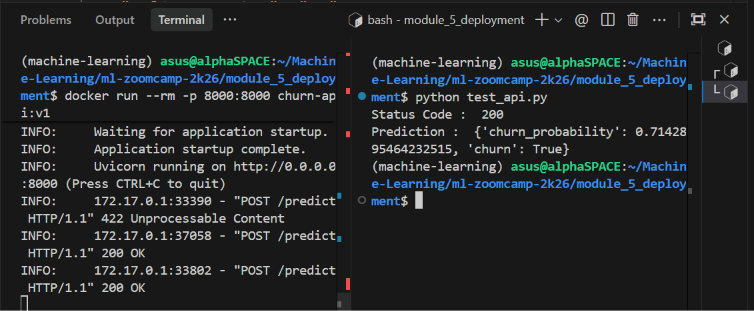
*Figure 6.1: Terminal session proving Uvicorn running inside Docker (left pane) and `python test_api.py` receiving HTTP 200 with `churn_probability: 0.7143` (right pane).*

---

### Dockerfile Breakdown & Layer Caching

Our [Dockerfile](Dockerfile) leverages multi-stage binary copying and dependency layer caching:

```dockerfile
# 1. Base runtime image
FROM python:3.13.11-slim

# 2. Multi-stage binary copy: copy precompiled uv from official image
COPY --from=ghcr.io/astral-sh/uv:latest /uv /uvx /bin/

# 3. Set container working directory
WORKDIR /app

# 4. Layer Caching: copy dependency declarations first
COPY pyproject.toml uv.lock ./

# 5. Fast dependency installation using locked tree
RUN uv sync --locked --no-dev --no-install-project

# 6. Copy application source and serialized artifact
COPY app.py /app/app.py
COPY pipeline.bin /app/pipeline.bin

# 7. Document exposed port
EXPOSE 8000

# 8. Start Uvicorn bound to all interfaces
CMD ["uv", "run", "--no-sync", "uvicorn", "app:app", "--host", "0.0.0.0", "--port", "8000"]
```

### Key Container Engineering Concepts:
1. **Layer Caching**: Step 4 (`COPY pyproject.toml uv.lock`) and Step 5 (`RUN uv sync`) are executed before copying application code. When `app.py` is edited, Docker reuses the cached dependency layer, rebuilding the container in **less than 1 second**.
2. **`0.0.0.0` vs. `127.0.0.1`**: Inside a container, `127.0.0.1` is the loopback interface, which rejects all traffic forwarded from outside the container. Binding to `0.0.0.0` tells Uvicorn to listen on all interfaces, allowing forwarded host packets to reach the app.
3. **`-p 8000:8000` vs. `EXPOSE 8000`**: `EXPOSE` is purely documentation. The `-p HOST:CONTAINER` option configures host iptables rules to actually route network traffic.

```bash
# Build and run commands:
docker build -t churn-prediction .
docker run --rm -p 8000:8000 churn-prediction
```

---

## Part 7 — GitHub Actions and CI/CD

### Automated CI/CD Workflow

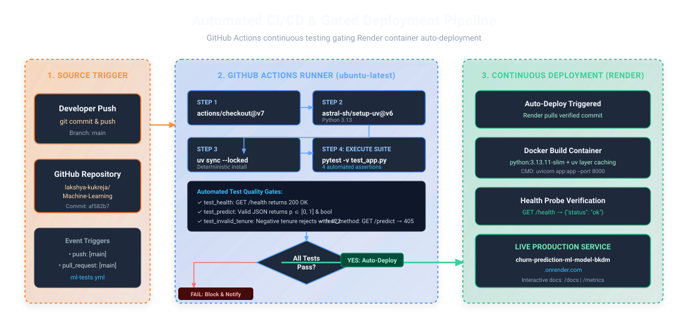
*Figure 7.1: Continuous integration workflow in GitHub Actions gating automated container deployments on Render.*

```mermaid
flowchart LR
    Push["git commit & push (main)"] --> Actions["GitHub Actions CI Runner"]
    
    subgraph CI_Job["ml-tests.yml Job"]
        Actions --> CheckOut["actions/checkout@v7"]
        CheckOut --> Setup["astral-sh/setup-uv@v6 (Python 3.13)"]
        Setup --> Sync["uv sync --locked"]
        Sync --> Pytest["pytest -v test_app.py"]
    end

    Pytest --> Gate{"All Tests<br/>Pass?"}
    Gate -->|"No"| Block["Block Deployment<br/>Notify Developer"]
    Gate -->|"Yes"| Trigger["Trigger Render Auto-Deploy Webhook"]

    subgraph CD_Release["Render Cloud Production"]
        Trigger --> Pull["Pull Latest Commit"]
        Pull --> DBuild["Build Docker Container"]
        DBuild --> Launch["Start Container (Port 8000)"]
        Launch --> Probe["Verify GET /health Probe"]
        Probe --> LiveProd["Live HTTPS Production"]
    end

    classDef pass fill:#064e3b,stroke:#10b981,stroke-width:1.5px,color:#a7f3d0;
    classDef fail fill:#450a0a,stroke:#ef4444,stroke-width:1.5px,color:#fca5a5;
    class LiveProd,Probe,Launch pass;
    class Block fail;
```

The workflow [.github/workflows/ml-tests.yml](../.github/workflows/ml-tests.yml) defines our automated CI quality gate:

```yaml
name: ML API Tests

on:
  push:
    branches: [main]
  pull_request:
    branches: [main]

jobs:
  test:
    runs-on: ubuntu-latest

    defaults:
      run:
        working-directory: module_5_deployment

    steps:
      - name: Checkout repository
        uses: actions/checkout@v7

      - name: Install uv and Python
        uses: astral-sh/setup-uv@v6
        with:
          python-version: "3.13"

      - name: Install dependencies
        run: uv sync --locked

      - name: Run API tests
        run: uv run --no-sync pytest -v test_app.py
```

- **CI vs. CD Distinction**: GitHub Actions is our **CI** (Continuous Integration) engine that verifies code correctness. Render is our **CD** (Continuous Deployment) host that builds and releases the container. Render is configured to deploy **only when GitHub Actions checks pass**.

---

## Part 8 — Render Deployment & Production Verification

### 8.1 Live Health Probe Verification

Accessing the `/health` endpoint over HTTPS confirms that Render has booted the container and can route external traffic:

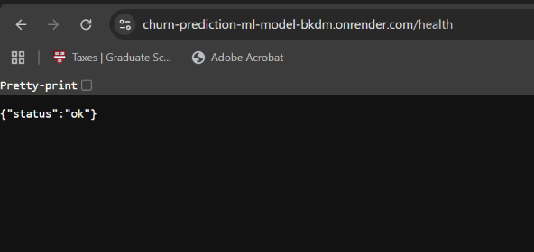
*Figure 8.1: Live browser confirmation of `{"status": "ok"}` on `https://churn-prediction-ml-model-bkdm.onrender.com/health`.*

---

### 8.2 Swagger UI & Local Inference Parity Check

To confirm that cloud containerization did not alter model weights or inference math, the exact same customer features were submitted to the live cloud Swagger UI and executed locally in `predict.py`:

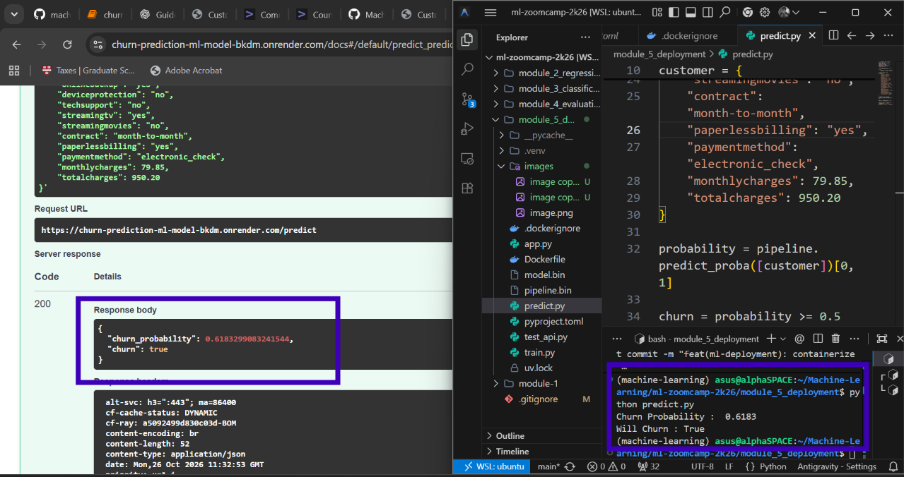
*Figure 8.2: Side-by-side verification proving identical probability outputs between Render Swagger UI (`0.6183299083241544`) and local Python inference (`0.6183`).*

---

### 8.3 Managing Free-Tier Cold Starts
Render spins down idle containers after 15 minutes of inactivity:
- **Cold start duration**: The first request to a sleeping instance takes 30–60 seconds while the VM allocates memory and Python initializes.
- **Client best practice**: External API clients must configure a request timeout of at least 60 seconds (`timeout=60`) to avoid false-positive connection timeout errors during wakeups.

---

## Part 9 — Logging, Error Handling & Monitoring

### 9.1 Structured Logging
Rather than unstructured `print()` statements, [app.py](app.py) configures standard Python logging:
```python
logging.basicConfig(
    level=logging.INFO,
    format="%(asctime)s | %(levelname)s | %(name)s | %(message)s"
)
```
- Logs startup milestones: `Model Loaded Successfully`.
- Logs per-request latency: `Prediction request latency: 0.0034 seconds`.
- Records full tracebacks internally on exceptions using `logger.exception()`.
- Customer PII (credit cards, names) is never logged.

### 9.2 In-Memory Telemetry (`GET /metrics`)
The application tracks basic operational vitals in memory:
```json
{
  "prediction_count": 14,
  "error_count": 0,
  "total_latency_seconds": 0.0482
}
```
- **Monitored via `time.perf_counter()`**: The most accurate monotonic clock for elapsed time benchmarks.
- **Limitations**:
  - Ephemeral: Resets to zero whenever the container restarts or wakes from sleep.
  - Process-Isolated: In multi-worker Uvicorn configurations, each worker process tracks its own separate counter.
  - Cumulative: Average latency requires dividing `total_latency_seconds` by `prediction_count`.
  - Prometheus/Grafana are planned future enhancements and are not currently integrated.

---

## Part 10 — Troubleshooting: Problems Worth Remembering

### Practical Troubleshooting Matrix

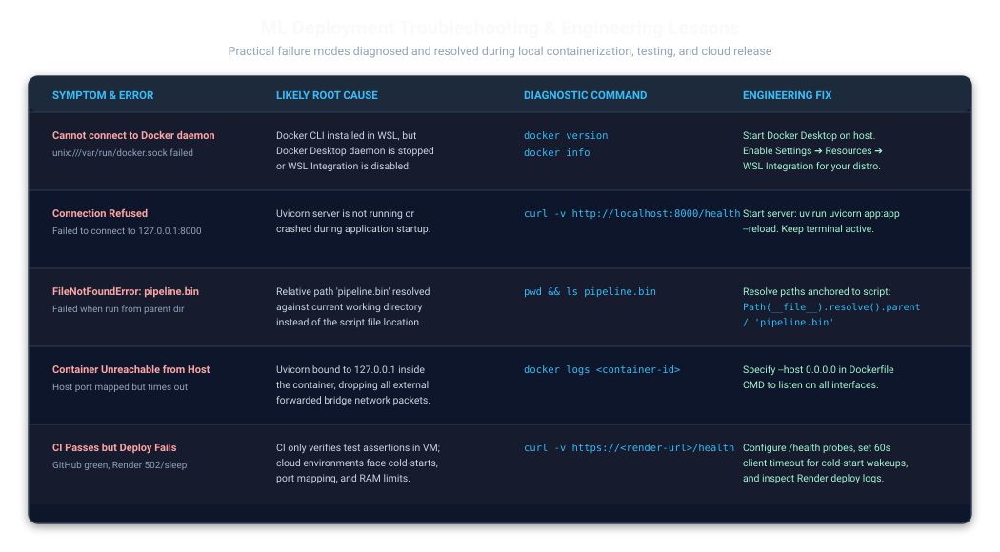
*Figure 10.1: Quick-reference diagnostic matrix covering the 5 most common failure modes in containerization, networking, and CI.*

| Problem & Symptom | Likely Root Cause | Diagnostic Command | Practical Solution |
| :--- | :--- | :--- | :--- |
| **Docker daemon unavailable in WSL**<br>`Cannot connect to the Docker daemon` | Docker Desktop is closed or WSL integration is disabled. | `docker version`<br>`docker info` | Open Docker Desktop on Windows. Go to **Settings ➔ Resources ➔ WSL Integration** and enable your Ubuntu distro. |
| **Local API connection refused**<br>`Failed to connect to 127.0.0.1 port 8000` | Uvicorn server is not running or crashed at boot. | `curl -v http://localhost:8000/health` | Launch the server from `module_5_deployment` using `uv run uvicorn app:app --reload`. Keep terminal open. |
| **`FileNotFoundError: pipeline.bin`** | Relative path `"pipeline.bin"` resolved against current working dir rather than script location. | `pwd`<br>`ls pipeline.bin` | In `app.py`, resolve paths relative to the script: `Path(__file__).resolve().parent / "pipeline.bin"`. |
| **Virtualenv warning / mismatch**<br>`uv warning: VIRTUAL_ENV ignored` | An active external terminal virtual environment conflicts with the project workspace. | `echo $VIRTUAL_ENV`<br>`which python` | Run `deactivate`, ensure you are in `module_5_deployment`, and run `uv sync --locked`. |
| **Port conflict (`Address already in use`)** | Another Uvicorn process or container is occupying port 8000. | `lsof -i :8000`<br>`netstat -tuln \| grep 8000` | Terminate the process (`kill -9 <PID>`) or map to a different host port: `docker run --rm -p 8001:8000 churn-prediction`. |
| **Container unreachable from host** | Uvicorn inside container bound to `127.0.0.1` instead of `0.0.0.0`. | `docker logs <container-id>` | Ensure the Dockerfile `CMD` specifies `--host 0.0.0.0`. `127.0.0.1` drops forwarded packets. |
| **`422 Unprocessable Entity`** | Request body missing required fields or violates constraints (e.g. `tenure: -1`). | Check response JSON detail array. | Compare request JSON against the Pydantic `Customer` model schema in `app.py` or inspect `/docs`. |
| **CI pipeline fails on GitHub**<br>`pytest: file not found: test_app.py` | GitHub Actions runner runs from repo root by default. | Check `.github/workflows/ml-tests.yml` run logs. | Add `defaults: run: working-directory: module_5_deployment` to the workflow job in `ml-tests.yml`. |
| **CI passes but live deployment fails** | Passing unit tests only proves code logic; doesn't prove cloud port routing or memory limits. | `curl -v https://<render-url>/health` | Set up automated `/health` probes, configure 60s client timeouts, and inspect Render deploy logs. |
| **Unnecessary Docker image rebuilding** | Confusion between building an image and running a container. | `docker images` | A Docker image only needs rebuilding when code or dependencies change. Re-run existing images directly. |

---

## Part 11 — Run the Project Yourself (Quick Start)

### Prerequisites
- **Git**: `git --version`
- **Python**: `3.11` or `3.13`
- **uv**: Install via Astral:
  ```bash
  curl -LsSf https://astral.sh/uv/install.sh | sh
  ```
- **Docker**: (Optional, for containerization) `docker --version`.

---

### Step-by-Step Execution Guide

```bash
# 1. Clone the repository
git clone https://github.com/lakshya-kukreja/Machine-Learning.git

# 2. Enter the deployment project directory
cd Machine-Learning/module_5_deployment

# 3. Synchronize locked dependencies deterministically
uv sync --locked

# 4. (Optional) Re-train and serialize the model pipeline
uv run python train.py
# Output: AUC = 0.857, Model saved to pipeline.bin

# 5. Run local standalone inference test
uv run python predict.py
# Output: Churn Probability : 0.6183, Will Churn : True

# 6. Execute the automated pytest suite
uv run pytest -v test_app.py
# Output: 4 passed in 0.42s

# 7. Start the local FastAPI server with auto-reload
uv run uvicorn app:app --host 0.0.0.0 --port 8000 --reload
```

In a separate terminal, test the running server:
```bash
# Verify health probe:
curl http://127.0.0.1:8000/health
# Output: {"status":"ok"}

# Run client script:
python test_api.py
# Output: Status Code : 200, Prediction : {'churn_probability': 0.7142895464232515, 'churn': True}

# Build and run Docker container:
docker build -t churn-prediction .
docker run --rm -p 8000:8000 churn-prediction
```

---

### Homework 5 Sub-Workspace (Course Lead Scoring)
The 2026 cohort homework model is maintained in its own dedicated workspace under `homework/05-deployment`:

```bash
cd homework/05-deployment
uv sync --locked
uv run python smoke_test.py
# Output: {'conversion_probability': 0.742385, 'conversion': True}

uv run uvicorn predict:app --host 0.0.0.0 --port 9696
# In another terminal:
python q6_test.py
```

---

## Part 12 — Project Structure & Component Manifest

```text
Machine-Learning/
├── .github/
│   └── workflows/
│       └── ml-tests.yml             # GitHub Actions CI workflow (Python 3.13 + uv + pytest)
├── .gitignore                       # Global git ignore configuration
└── module_5_deployment/              # ACTUAL ROOT of the ML Deployment Project
    ├── .dockerignore                # Excludes caches, venvs, notebooks, and raw data
    ├── Dockerfile                   # Multi-stage container recipe with uv layer caching
    ├── pyproject.toml               # Project metadata, dependencies, and uv workspace config
    ├── uv.lock                      # Cryptographically locked universal dependency tree
    ├── app.py                       # Production FastAPI serving app (lifespan, validation, metrics)
    ├── train.py                     # Offline training, feature engineering, and pipeline serialization
    ├── predict.py                   # Standalone CLI inference script for local pipeline validation
    ├── test_app.py                  # Pytest test suite (health, predict, 422 boundary, 405 verb)
    ├── test_api.py                  # Client test script sending live POST requests to port 8000
    ├── pipeline.bin                 # Serialized scikit-learn Pipeline (DictVectorizer + LogisticRegression)
    ├── model.bin                    # Legacy standalone estimator artifact (reference)
    ├── assets/                      # Repository visual assets, diagrams, and verified screenshots
    │   ├── project-hero.svg         # Visual A: Project hero banner
    │   ├── system-architecture.svg  # Visual B: End-to-end system architecture diagram
    │   ├── ml-deployment-lifecycle.svg # Visual C: Model-to-production lifecycle diagram
    │   ├── model-roc-curve.png      # Offline Evaluation: ROC Curve Comparison (AUC 0.857)
    │   ├── model-cv-tuning.png      # Offline Evaluation: 5-Fold Cross Validation for C=0.5
    │   ├── model-confusion-matrix.png # Offline Evaluation: Confusion Matrix Heatmap (t=0.50)
    │   ├── api-request-lifecycle.svg# Visual E: API request/response flow sequence diagram
    │   ├── api-contract-card.svg    # Visual F: Request and response contract card
    │   ├── test-suite-matrix.svg    # QA Matrix: 4 Automated Pytest Quality Gates
    │   ├── docker-container-test.png# Verified screenshot: Docker container execution & test
    │   ├── cicd-workflow.svg        # Visual D: Automated CI/CD pipeline workflow diagram
    │   ├── render-live-health.png   # Verified screenshot: Render cloud health probe
    │   ├── render-swagger-prediction-parity.png # Verified screenshot: Render Swagger UI vs local parity
    │   └── troubleshooting-matrix.svg # Visual G: Debugging & engineering lessons matrix
    ├── homework/
    │   └── 05-deployment/           # ML Zoomcamp 2026 Cohort Homework 5 (Lead Scoring)
    │       ├── Dockerfile           # Homework container definition pinned by digest
    │       ├── pyproject.toml       # Homework-specific dependencies
    │       ├── uv.lock              # Locked dependencies for Homework 5
    │       ├── model.py             # Feature schemas and training-time median imputation
    │       ├── train.py             # Lead scoring pipeline training script
    │       ├── predict.py           # Homework FastAPI serving service (port 9696)
    │       ├── smoke_test.py        # Deterministic inference test
    │       ├── q6_test.py           # Question 6 integration test client
    │       ├── pipeline.bin         # Lead scoring serialized pipeline artifact
    │       ├── feature_defaults.json# Median imputation defaults from training data
    │       └── model_metadata.json  # Checksums (SHA256) of model and feature defaults
    └── README.md                    # Main deployment documentation (this file)
```

---

## Part 13 — Interview and Revision Notes (5-Minute Prep)

```
┌────────────────────────────────────────────────────────────────────────┐
│                   5-MINUTE ML DEPLOYMENT REVISION MAP                  │
├───────────────────────────────────┬────────────────────────────────────┤
│ 1. Preventing Skew                │ 2. Lifespan Loading                │
│ Bundle DictVectorizer and         │ Load pipeline.bin once during      │
│ LogisticRegression into a single  │ FastAPI lifespan startup; never    │
│ Pipeline so encoding logic never  │ unpickle inside endpoint routes    │
│ drifts between train and serve.   │ to avoid disk I/O bottlenecks.     │
├───────────────────────────────────┼────────────────────────────────────┤
│ 3. Boundary Contracts             │ 4. Docker Layer Caching            │
│ Pydantic v2 Field(ge=0) catches   │ Copy pyproject.toml & uv.lock      │
│ out-of-bounds numbers at the edge │ first to cache dependency installs │
│ (HTTP 422) before consuming ML    │ so code updates rebuild in <1 sec. │
│ matrix computation cycles.        │                                    │
├───────────────────────────────────┼────────────────────────────────────┤
│ 5. Network Interfaces             │ 6. CI Gating vs. CD                │
│ Containers must bind to 0.0.0.0   │ GitHub Actions CI tests code in a  │
│ to accept forwarded host packets; │ VM; Render auto-deploys only when  │
│ 127.0.0.1 drops external traffic. │ CI passes; verify /health after.   │
└───────────────────────────────────┴────────────────────────────────────┘
```

### High-Yield Interview Q&A

#### Q1: What is training-serving skew, and how did your implementation prevent it?
> **Answer**: Training-serving skew occurs when data transformations applied during training differ from transformations applied during real-time inference. In our implementation, we prevented skew by using `sklearn.pipeline.make_pipeline(DictVectorizer(sparse=False), LogisticRegression(...))`. The vectorizer and estimator are serialized together into `pipeline.bin`. During inference, the exact same vocabulary and transformation matrix learned during training are applied to the incoming dictionary.

#### Q2: Why should you avoid unpickling a model inside an endpoint function?
> **Answer**: Unpickling a model inside an endpoint forces Python to read the binary file from disk and reconstruct the object graph on every incoming HTTP request. For a model receiving 100 requests per second, this causes severe I/O bottlenecks and latency spikes. Instead, we use FastAPI's `@asynccontextmanager` lifespan handler to load `pipeline.bin` into memory once during server boot, allowing requests to perform inference concurrently against the in-memory object.

#### Q3: Why is FastAPI preferred over traditional Flask for modern ML deployment?
> **Answer**: FastAPI offers several key engineering advantages:
> 1. Native asynchronous support built on ASGI/Uvicorn, enabling high concurrent I/O throughput.
> 2. Native Pydantic integration providing automatic runtime type validation, serialization, and boundary checks.
> 3. Automatic generation of interactive OpenAPI documentation (Swagger UI at `/docs` and ReDoc at `/redoc`).
> 4. Structured error responses (returning HTTP 422 with detailed JSON field traces on validation failure).

#### Q4: Why must a containerized application bind to `0.0.0.0` instead of `127.0.0.1`?
> **Answer**: Inside a Linux network namespace, `127.0.0.1` is the loopback interface, meaning the process will only accept connections originating from inside that container. `0.0.0.0` binds the process to all available network interfaces inside the container, allowing traffic forwarded from the Docker host's bridge network or cloud load balancers to reach the application.

#### Q5: In a Dockerfile, what is the difference between `EXPOSE` and the `-p` run flag?
> **Answer**: `EXPOSE` is metadata documentation inside the image that informs users and orchestrators which port the containerized process listens on; it does not actually publish the port or grant network access. The `-p <host_port>:<container_port>` flag actively instructs the Docker daemon to configure `iptables` / NAT rules on the host to forward network traffic from the specified host port into the container port.

#### Q6: How does Docker layer caching improve build efficiency in our Dockerfile?
> **Answer**: Docker builds images in ordered, cached layers. By copying only `pyproject.toml` and `uv.lock` first and running `uv sync`, Docker creates a cached layer containing all installed Python packages. We only copy `app.py` and `pipeline.bin` in later steps. When application code changes, Docker reuses the cached dependency layer, reducing rebuild time from minutes to under a second.

#### Q7: What does an HTTP 422 status code mean, and why is it valuable for ML APIs?
> **Answer**: HTTP 422 Unprocessable Entity indicates that the server understands the content type and syntax of the request, but the contained data violates validation constraints. For an ML API, this prevents corrupted or out-of-bounds data (such as negative tenure or missing demographic attributes) from silently reaching matrix multiplication routines, returning a clear JSON explanation to the client instead of raising an internal HTTP 500 error.

#### Q8: How does GitHub Actions continuous integration improve model deployment reliability?
> **Answer**: Automated CI acts as a quality gate. Every push or pull request runs `pytest` in an isolated virtual machine. If a code change breaks the input schema, invalidates health checks, or changes prediction output shapes, the test job fails. Because Render is configured to deploy only after CI checks pass, breaking changes are intercepted before reaching production.

#### Q9: What are the limitations of the in-memory `/metrics` endpoint implemented in `app.py`?
> **Answer**: The in-memory metrics counter stores values in a Python dictionary. Its limitations include:
> 1. Ephemeral: Metrics are lost whenever the container restarts or spins down.
> 2. Multi-Worker Isolation: In a multi-worker setup (e.g., Uvicorn with multiple workers or Kubernetes pods), each process maintains isolated counters without aggregation.
> 3. Security: The endpoint is unauthenticated, potentially exposing operational traffic volume.
> A production setup should export metrics to a durable time-series database using Prometheus and visualize them with Grafana.

#### Q10: How do you handle cold starts when deploying containerized ML models to serverless or free-tier platforms?
> **Answer**: Free-tier cloud platforms (like Render or AWS Lambda) spin down idle instances to conserve resources. When a new request arrives, cold-start latency occurs as the VM boots and Python imports libraries. Mitigation strategies include:
> 1. Setting client-side timeouts to 60+ seconds.
> 2. Implementing automated keep-alive pings (cron jobs sending lightweight `GET /health` requests every 10 minutes).
> 3. Minimizing Docker image size using slim base images (`python:3.13-slim`).
> 4. Upgrading to paid instances with persistent instances or provisioned concurrency.

---

## References & Author Context

### Primary Repositories
- **Primary Implementation Snapshot**: [lakshya-kukreja/Machine-Learning (module_5_deployment)](https://github.com/lakshya-kukreja/Machine-Learning/tree/af582b7ce5924fe56dbe0d5f33a1664045336c60/module_5_deployment)
- **Course Reference Repository**: [DataTalksClub Machine Learning Zoomcamp — Deployment Workshop](https://github.com/DataTalksClub/machine-learning-zoomcamp/tree/9bb19da5777191f0dc0a038f93ef1b429db5a2bb/05-deployment/workshop)
- **Course 2026 Homework 5**: [Homework 5 Specification](homework/05-deployment/homework.md)

### Official Documentation
- **FastAPI Framework**: [https://fastapi.tiangolo.com/](https://fastapi.tiangolo.com/)
- **Uvicorn ASGI Server**: [https://www.uvicorn.org/](https://www.uvicorn.org/)
- **Pydantic Data Validation**: [https://docs.pydantic.dev/latest/](https://docs.pydantic.dev/latest/)
- **Astral uv Package Manager**: [https://docs.astral.sh/uv/](https://docs.astral.sh/uv/)
- **Docker Documentation**: [https://docs.docker.com/](https://docs.docker.com/)
- **Scikit-Learn Pipelines**: [https://scikit-learn.org/stable/modules/compose.html](https://scikit-learn.org/stable/modules/compose.html)
- **GitHub Actions**: [https://docs.github.com/en/actions](https://docs.github.com/en/actions)
- **Render Cloud Hosting**: [https://render.com/docs](https://render.com/docs)
- **Pytest Testing Framework**: [https://docs.pytest.org/](https://docs.pytest.org/)
